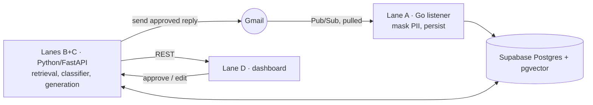

# AImail

AI-powered corporate email assistant. Ingests Gmail, masks PII before anything is stored, grounds
replies in company policy via RAG, drafts context-aware replies with a multi-agent pipeline, and
surfaces them in a dashboard for human approval.

Final-year project (Monash University Malaysia, FIT3163) — Group MDS25, supervised by Dr. Asad Malik.

**Live demo:** https://ai-mail-nu.vercel.app/ (no sign-in needed; runs in the browser with no backend or AI calls).

**Lane D (Han):** the 14-field typed data contract the backend adopted, the review dashboard, the Chrome extension prototype, the no-sign-in demo mailbox, and code review of teammates' pull requests.

## Architecture



See [`specs/architecture.md`](specs/architecture.md) for the full component + seam breakdown.

| Lane | Owner | Folder | Responsibility |
|------|-------|--------|----------------|
| A | JiaJun | `listener/` | Go: Gmail + Pub/Sub, PII masking, Supabase persistence + audit |
| B | Elyesa | `backend/app/rag`, `backend/app/ml` | RAG retrieval, priority classifier, eval |
| C | hanif | `backend/email_agent.py` | Reply generation (route → summarize → draft → critic) |
| D | Han | `frontend/` | Dashboard (Vite/React) and Chrome extension |

## Features

Each links to its spec in [`specs/features/`](specs/features/).

- Sign in with Google, which also connects that user's Gmail; every query is scoped to its owner
  ([`per-user-mailboxes.md`](specs/features/per-user-mailboxes.md)).
- PII masked in the listener before storage; a message is quarantined with no content while
  Presidio is down ([`architecture.md`](specs/architecture.md)). Attachments are read locally first
  ([`attachment-reading.md`](specs/features/attachment-reading.md)).
- Restorable masking: numbered placeholders with an encrypted vault, so a sent reply carries the
  real details ([`restorable-masking.md`](specs/features/restorable-masking.md)).
- Drafts on Gemini, or on the company's local model in Private mode
  ([`local-model.md`](specs/features/local-model.md)).
- Priority and category, inbox sorted most urgent first, search and Ask AIMail.
- Send later and quiet hours ([`quiet-hours-send-later.md`](specs/features/quiet-hours-send-later.md)),
  holding replies ([`holding-reply.md`](specs/features/holding-reply.md)), reply templates, and a
  To-do page in tabs, each row with its next step, Undo and Remind me later
  ([`todo-page.md`](specs/features/todo-page.md),
  [`todo-redesign-and-status.md`](specs/features/todo-redesign-and-status.md)).
- A public service status page at `/status`.
- Sender verification and a hash-chained audit log
  ([`sender-verification-and-audit.md`](specs/features/sender-verification-and-audit.md)).
- A Chrome side panel in Gmail ([`chrome-extension.md`](specs/features/chrome-extension.md)) and a
  phone layout ([`mobile-layout.md`](specs/features/mobile-layout.md)).

## Tech stack

Python + FastAPI (backend), Go (listener), Vite/React/TypeScript (frontend), Supabase
(Postgres + pgvector), Gemini (embeddings, retrieval, and Lane C generation), a local model for
Private mode, Presidio (PII detection).
Pinned versions: [`specs/context/tech-stack.md`](specs/context/tech-stack.md).

## Running the stack

Server-side services share the root `.env` (copy from [`.env.example`](.env.example)); the
dashboard keeps its own public env (`VITE_BACKEND_URL`). The listener ingests every connected
mailbox. `listener/token.json`, if present, only signs the listener in to Pub/Sub on a developer's machine
(see [`listener/README.md`](listener/README.md)).

**Create the tables** (needs `DATABASE_URL`): `make migrate` applies the pending migrations in
`backend/app/db/migrations/` (43 today) in order and records each in `schema_migrations`.

**Start everything:** `make dev` (runs [`dev.sh`](dev.sh)) starts, in one terminal:

- Presidio and the attachment reader via `docker compose up -d` (analyzer :5001, anonymizer :5002,
  attachment reader :5003, all bound to 127.0.0.1; see [`docker-compose.yml`](docker-compose.yml));
- the backend API on :8000, the Lane C agent on :8001 (bound to 127.0.0.1), and the background
  worker (`python -m app.worker`);
- the dashboard on :8090;
- the listener, restarted after 5 seconds if it exits.

Ports 8000, 8001 and 8090 are freed first; :8080 is left alone for other local projects. Stop with
Ctrl+C, not Ctrl+Z. Each service also has its own target: `make backend`, `make agent`,
`make worker`, `make web`.

**Authentication.** The dashboard uses a Google sign-in session. Scripts and tests call the API
with `Authorization: Bearer <BACKEND_API_TOKEN>`. That token stays server-side: never put it in a
`VITE_` variable, which would ship it to the browser. Details:
[`backend/app/core/auth.py`](backend/app/core/auth.py).

**Test the pipeline without the Gmail setup** by inserting a sample email as the listener would:
```bash
cd backend
../.venv/bin/python scripts/seed_message.py
curl -H "Authorization: Bearer $BACKEND_API_TOKEN" localhost:8000/emails
curl -H "Authorization: Bearer $BACKEND_API_TOKEN" localhost:8000/emails/<id-from-above>   # with a Lane C draft
```

REST routes: [`specs/context/api-contracts.md`](specs/context/api-contracts.md).

**Checks:** `make check` runs the backend tests and ruff; the dashboard typecheck, palette check,
eslint and unit tests; a check that the dashboard's generated API types match the backend; and
the listener's `go vet`, `gofmt` and `go test -short` (skipped when Go is not installed).
`make hooks` makes `git push` run it first. `make help` lists the other targets (eval, ingest,
classifier training).

**Hosted deployment:** the dashboard on Vercel and the backend services on Render from `render.yaml`
(API/agent web service, private Presidio analyzer, private attachment reader, and background listener worker).
Setup steps and architecture: [`specs/features/free-hosting.md`](specs/features/free-hosting.md).

## Contributing

Branch/PR flow and the spec-first workflow: [`CONTRIBUTING.md`](CONTRIBUTING.md) and
[`docs/git-workflow.md`](docs/git-workflow.md). Cross-lane contracts live in
[`backend/app/contracts.py`](backend/app/contracts.py) + [`specs/context/`](specs/context/) —
change the shape there first, then implement.

## Copyright

© 2026 Group MDS25, Monash University Malaysia. All rights reserved.
