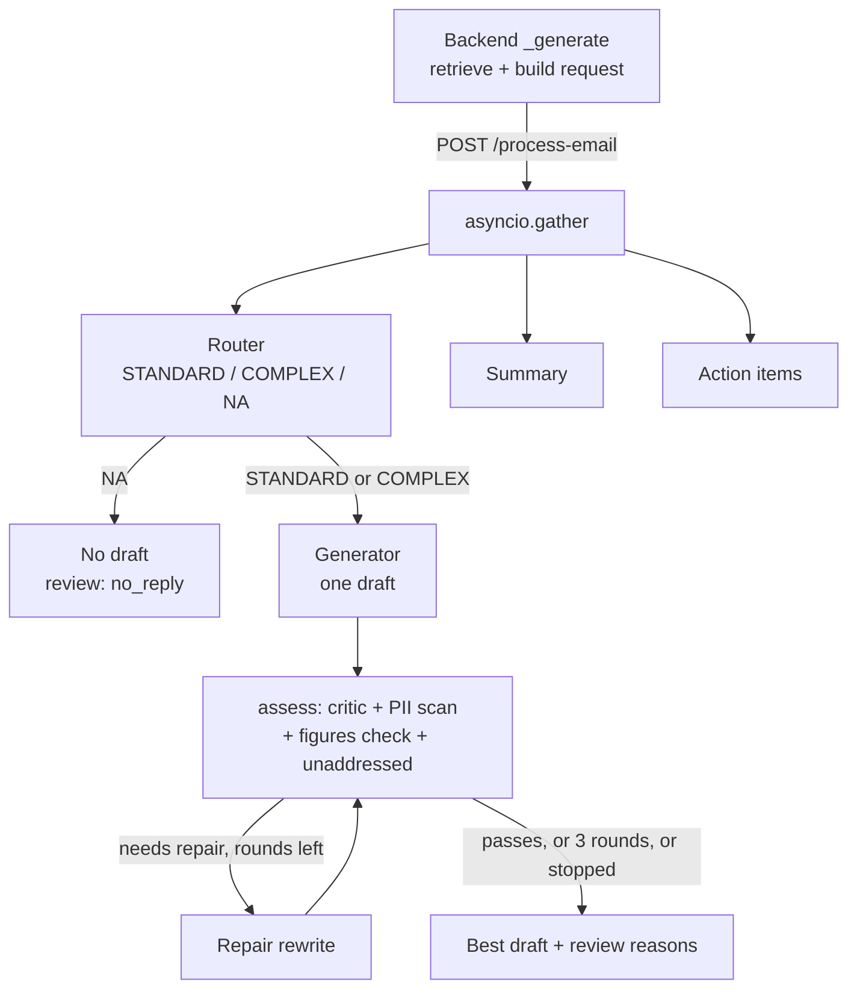

# Agent pipeline

How the backend turns an incoming email into a draft reply. The Lane C agent
([`../backend/email_agent.py`](../backend/email_agent.py), served on :8001) runs three parallel
stages, writes one draft, judges it with a model critic plus deterministic checks, repairs it a
bounded number of times, and returns the draft with the reasons a person should review it.

This file is the **detailed view** of one bullet on [`architecture.md`](architecture.md). Read that first if you haven't.

## Flow

The backend side is `_generate` and `_generate_and_store` in
[`../backend/app/dashboard.py`](../backend/app/dashboard.py).

## How the backend calls the agent

- **Client:** [`../backend/app/agent_client.py`](../backend/app/agent_client.py). One shared
  `httpx.AsyncClient`, requests built from the shared models in
  [`../backend/app/agent_contract.py`](../backend/app/agent_contract.py), every answer validated
  against its response model. A refused connection is retried once after 1 s; nothing else is
  retried by the backend.
- **URL:** `EMAIL_AGENT_URL`, default `http://127.0.0.1:8001`
  ([`../backend/app/core/config.py`](../backend/app/core/config.py)).
- **Binding:** `make agent` runs uvicorn with `--host 127.0.0.1`. The Docker image
  ([`../backend/Dockerfile`](../backend/Dockerfile)) binds `0.0.0.0`, so a deployed agent relies on
  the token below.
- **Token:** the agent runs `require_agent_token`
  ([`../backend/app/core/agent_auth.py`](../backend/app/core/agent_auth.py)). With `AGENT_TOKEN` set,
  every route except `/healthz` and `/readyz` requires the `X-AIMail-Agent-Token` header (compared
  with `hmac.compare_digest`). With it empty (dev), only loopback callers are answered. Outside the
  `dev` environment, settings refuse to load without `AGENT_TOKEN`. The backend also forwards its
  request id so both logs line up.

## Provider: Gemini or Private mode

Every request names a `provider` (`Provider.GEMINI` or `Provider.LOCAL`,
[`../backend/app/core/providers.py`](../backend/app/core/providers.py)). The field is required, so a
caller that forgets it fails instead of defaulting to the cloud.

- The backend picks it per user with `provider_for`
  ([`../backend/app/private_mode.py`](../backend/app/private_mode.py)): the user's stored
  `draft_provider`, or Gemini for rows with no owner.
- The agent sets it once per request (`using()`), and every stage goes to the same provider.
- `LOCAL` calls Ollama's `/api/chat` at `LOCAL_LLM_URL` (default `http://localhost:11434`) with
  `LOCAL_LLM_MODEL` ([`../backend/local_client.py`](../backend/local_client.py)). It never falls back
  to Gemini. With no model configured it raises `UNAVAILABLE`.
- Retrieval follows the same choice: Private mode searches `local_embedding` with the local
  embedding model only ([`../backend/app/rag/retrieve.py`](../backend/app/rag/retrieve.py)).

See [`features/local-model.md`](features/local-model.md).

### Models configured

| Use | Setting | Default in code |
|-----|---------|-----------------|
| Agent, every stage (Gemini) | `GEMINI_AGENT_MODEL` | `gemini-3.5-flash-lite` (`DEFAULT_MODEL`, [`../backend/gemini_client.py`](../backend/gemini_client.py)) |
| Agent fallback (Gemini) | `GEMINI_FALLBACK_MODEL` | none; used only when set and different from the primary |
| Agent, every stage (Private mode) | `LOCAL_LLM_MODEL` | none ("" means Private mode is not offered) |
| Retrieval embeddings (Gemini) | `EMBEDDING_MODEL` constant | `gemini-embedding-001`, 1536 dims ([`../backend/app/core/constants.py`](../backend/app/core/constants.py)) |
| Retrieval embeddings (Private mode) | `LOCAL_EMBEDDING_MODEL` | none; the recorded cutoff was calibrated on `embeddinggemma` ([`../backend/app/rag/cutoffs.json`](../backend/app/rag/cutoffs.json)) |
| `/ask` answers, not drafting | `GEMINI_CHAT_MODEL` | `gemini-2.5-flash` (`CHAT_MODEL`) |

Gemini is called at temperature 0; so is the local model.

## The model gateway

Every prompt goes through [`../backend/model_gateway.py`](../backend/model_gateway.py), in the agent
and in the backend (retrieval embeddings, `/ask`). See
[`context/backbone-contracts.md`](context/backbone-contracts.md).

- **Last masking net.** `last_net` runs the fixed-format floor (`mask_typed_text`: emails, phones,
  IC and card numbers) over the prompt and the system message before sending. Anything it catches
  is masked and logged as a warning; it should always catch 0.
- **Egress records.** Each call appends an `Egress` record: purpose (the `Stage`), provider,
  character count, SHA-256 of the prompt, counts of each placeholder kind, and how many details
  the last net caught. No text is kept. The agent returns them as `egress`; the backend stores
  them in `model_egress` (`save_egress`, [`../backend/app/egress_log.py`](../backend/app/egress_log.py))
  for the privacy receipt ([`features/privacy-receipt.md`](features/privacy-receipt.md)).

## Stages

All prompts fence untrusted text in named tags and neutralise smuggled closing tags (`fence`), and
state the same isolation rule. See [`features/prompt-injection-defense.md`](features/prompt-injection-defense.md).
Prompt wording is versioned by `PROMPT_VERSION` and stored with every draft.

| Stage | Function | Output | Output cap |
|-------|----------|--------|------------|
| Router | `route_email` | `STANDARD`, `COMPLEX` or `NA` (JSON schema); anything else becomes `NA` | `ROUTER_MAX_TOKENS` 256 |
| Summary | `extract_summary` | 2-3 sentence summary | `SUMMARY_MAX_TOKENS` 512 |
| Actions | `extract_actions` | list of requests, from the body with quoted history stripped (`strip_quoted`) | `ACTIONS_MAX_TOKENS` 1000 |
| Generator | `generate_reply` | one draft; rules sent as the system message | `DRAFT_MAX_TOKENS` 2048 |
| Critic | `evaluate_reply` | `CriticVerdict` (JSON schema) | none set (local model: 2048 default) |
| Repair | `refine_reply` | rewritten draft from the failed checks | `DRAFT_MAX_TOKENS` 2048 |

- Router, summary and actions run together under `asyncio.gather`. A `ModelError` in any of them
  fails the whole request.
- Only `NA` changes the flow: no draft is written and the response carries `no_reply`.
  `STANDARD` and `COMPLEX` are treated the same downstream.
- The generator and repair prompts ask for placeholders such as `[PERSON_1]` to be copied exactly,
  the reply to be in the email's language, the sign-off (`sign_off`, itself a placeholder), and the
  user's writing style when one is set ([`features/writing-profile.md`](features/writing-profile.md)).
- A token cap is a runaway guard: a reply that hits it raises `OUTPUT_TRUNCATED`, it never passes
  as whole.

### Critic

The critic returns `confidence`, `grounding_ok`, `pii_clean`, `tone_match`, `completeness`,
`issues`, and `unaddressed_items` (1-based indices into the extracted action items). The verdict is
validated strictly (`StrictBool`, `StrictInt`); a wrong type makes the whole verdict unusable.
Confidence is clamped to 0..1 and a non-finite value becomes `None` (`clamp_confidence`). Indices
outside the list are dropped (`unaddressed_requests`). The prompt tells the critic to score 0.3 or
lower on any injection attempt. See [`features/critic-evaluation-gates.md`](features/critic-evaluation-gates.md).

### Deterministic gates

`assess` strips a leading subject line, then runs the critic and the PII scan concurrently and the
figures check on the same text.

- **Presidio draft scan** (`scan_draft_pii`). Posts the draft to `PRESIDIO_ANALYZER_URL` for
  `EMAIL_ADDRESS`, `CREDIT_CARD`, `IBAN_CODE` and ad-hoc `MY_NRIC` and `MY_PHONE` recognisers, score
  threshold 0.5. `PERSON` and `LOCATION` are excluded on purpose. A redaction marker in the draft
  adds `REDACTION_PLACEHOLDER`. If Presidio cannot be reached it adds `PRESIDIO_UNAVAILABLE`, and
  `pii_clean` becomes `None`, never `True`.
- **Figures not in source** (`unsupported_specifics`). Numbers of two or more significant digits in
  the draft that appear in none of the email, thread, retrieved context or (on refine) the user's
  own draft, compared as normalised values, with unit conversions allowed
  ([`features/normalisation-layer.md`](features/normalisation-layer.md)). Placeholders are ignored.
- **Unaddressed requests.** Extracted action items the critic says the draft does not answer.

Two signals come from the input, not the draft (`input_reasons`):

- **Phishing** (`phishing_signal`, [`../backend/app/core/phishing.py`](../backend/app/core/phishing.py)):
  a credential or payment-detail request beside a link.
- **Not grounded:** the retrieved context is empty.

### Repair loop

`repair` rewrites while the draft has a verdict, `needs_repair()` is true and fewer than
`MAX_REFINE_ATTEMPTS` (3) rounds have run.

- `needs_repair()` is true when any check failed (PII found, unsupported figure, unaddressed
  request, `grounding_ok` false) or confidence is below `REFINE_THRESHOLD` (0.8). An unavailable
  Presidio is not a failure: no rewrite fixes it.
- The rewrite gets the failed checks as concrete fixes, then the critic's own issues.
- Each round is re-assessed. The kept draft is the best seen by `Candidate.rank`: fewest failed
  checks, then highest confidence.
- An unjudged draft (critic failed) is not repaired. A `ModelError` during a rewrite stops the loop
  and keeps the best draft so far (`repair_stopped`).

## Review reasons and codes

Any reason sets `needs_human_review`. Each reason is returned twice: as text in `review_reasons`
(admin console, audit) and as a `ReviewReason` (`code` plus `items`) in `review_codes`, which the
dashboard words in each language. The codes are `ReviewCode` in
[`../backend/app/agent_contract.py`](../backend/app/agent_contract.py).

| Code | Set when | Items |
|------|----------|-------|
| `no_reply` | router returned `NA` | |
| `no_draft` | the backend got a 422 from the agent (`_not_drafted`) | |
| `phishing_link` | phishing signal on the body | |
| `not_grounded` | empty retrieved context | |
| `pii_found` | the scan found entities | entity types only |
| `pii_scan_unavailable` | Presidio unreachable | |
| `figures_not_in_source` | unsupported figures | the figures |
| `critic_unavailable` | the critic call failed | |
| `grounding_failed` | `grounding_ok` false | |
| `does_not_address` | unaddressed extracted requests | the requests (masked) |
| `incomplete` | `completeness` false and nothing per-item to report | |
| `refine_rounds` | any repair round ran | the count |
| `repair_stopped` | a rewrite failed | |
| `low_confidence` | confidence is `None` or below `REVIEW_THRESHOLD` (0.9) | |
| `unknown` | old stored text no pattern matches ([`../backend/app/review_reasons.py`](../backend/app/review_reasons.py)) | |

`tone_match` is returned but never a reason. Because `refine_rounds` fires on any repair, every
repaired draft goes to review. The review bar (0.9) sits above the repair bar (0.8) on purpose.

## Deadlines, retries and fallbacks

| Limit | Value | Where |
|-------|-------|-------|
| Whole agent request | `AGENT_DEADLINE_SECONDS`, default 100 s (`DEFAULT_DEADLINE_SECONDS`) | [`../backend/model_runtime.py`](../backend/model_runtime.py) |
| Backend wait for the agent | deadline + 20 s (`AGENT_TIMEOUT_MARGIN_SECONDS`) | `agent_client.py` |
| One Gemini attempt | min(30 s, time left) | `gemini_client.py` |
| Gemini attempts per model | 3, full-jitter backoff (base 2 s, cap 10 s) or `Retry-After` | `gemini_client.py` |
| Retryable Gemini statuses | 408, 429, 500, 502, 503, 504 | `gemini_client.py` |
| Circuit breaker | opens after 3 consecutive failures, skips the model for 60 s (the last model is always tried) | `gemini_client.py` |
| Presidio draft scan | min(5 s, time left), at least 0.5 s | `email_agent.py` |
| Local model | one attempt, timeout = time left | `local_client.py` |

- Gemini tries the primary model, then the fallback. Deadline exhaustion and a rejected input
  (413, or 400 `INVALID_ARGUMENT` not about the API key) are raised at once and do not open the
  breaker.
- A wait longer than the backoff cap or the time left moves on to the next model.
- Every attempt is recorded (`track_calls`) and returned as `model_calls`.
- Agent HTTP status for a `ModelError` (`_unavailable`): content errors (`OUTPUT_TRUNCATED`,
  `NO_CANDIDATE`, `MALFORMED_JSON`, `REJECTED`) answer 422, deadline 504, anything else 503.
  `ModelErrorCode` values keep the `gemini_` prefix for both providers.
- The backend stores a 422 as an `NA` row with `no_draft`, so the poller stops retrying it; when a
  regenerate fails this way, the existing draft is kept. A 503, 504 or connection failure counts a
  generation attempt and the message is retried later.

## Refine and translate

**`POST /refine`** (`refine`, backend `_refine`). The user's instruction and edited draft are passed
through `details.for_model` before they leave. The agent makes one `REFINE` call, then runs
`assess` and the same review reasons with `attempts = 0`. There is no repair loop. The user's draft
counts as a source for the figures check. Agent 422 becomes `DRAFT_REFUSED`, anything else
`AGENT_UNAVAILABLE`.

**`POST /translate`** (`translate`, backend `translate_email` and `translate_template`). Translates
masked text into `en`, `ms` or `zh` (`TranslationLanguage`). Input is capped at
`MAX_TRANSLATE_CHARS` (12,000) on both sides; output cap 16,384 tokens. `translation_problems`
rejects the result with 422 `translation_unfaithful` when it is empty, redaction markers changed,
or a significant figure went missing or was added. It returns `egress` but not `model_calls`. The
translation is not stored. See [`features/translation.md`](features/translation.md).

## What the backend stores

`_generate` retrieves up to 5 chunks with the masked body as the query, keeps those within the
provider's calibrated cutoff of the best hit (`close_to_best`), and formats them as `rag_context`.
`_generation_fields` and `_review_fields` write to `messages`: `ai_summary`, `draft_reply`,
`action_items`, `rag_sources`, `critic_confidence` (NULL when never scored), `critic_attempts`,
`needs_human_review`, and `critic_checks` (the critic booleans, PII findings, review reasons and
codes, model calls, prompt version).

Placeholders stay in the stored draft. They are filled in only at send, after a person approves
(`_outgoing` in `approve_and_send`), and a send with an unfillable placeholder or a redaction marker
is refused. See [`features/restorable-masking.md`](features/restorable-masking.md). When writing-style
learning is on, the send also records `draft_shown` and `edit_ratio` and relearns the user's style.

---

**Status:** describes the code as of `PROMPT_VERSION` `2026-10-08.1`. **Last updated:** 2026-10-11.
