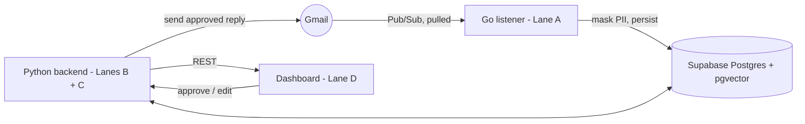

# AImail — Architecture & Cross-lane Sync

Living reference for how the lanes fit together and where their contracts meet. Last checked
against the code on 2026-10-11.

## Lane ownership

| Lane | Owner | Folder | Builds |
|------|-------|--------|--------|
| A · Spine + privacy | JiaJun | `listener/` | Go listener: Gmail + Pub/Sub, PII masking, Supabase persistence + audit log |
| B · ML + retrieval | Elyesa | `backend/app/` | RAG (embed/store/retrieve), priority classifier, eval |
| C · Generation | hanif | `backend/email_agent.py` | reply generation |
| D · Surfaces | Han | `frontend/frontend/mail-clarity-dash-main/` | Vite/React dashboard and the Chrome extension |

## Flow (as actually built)

n8n is not in the pipeline. Lane A ingests straight from the Gmail API + Pub/Sub, and outbound
send is the backend calling the Gmail API directly, with the owner's own Google connection
(`mailbox_connection`), or `token.json` for the original mailbox's unowned rows
(`backend/app/gmail_send.py`). The n8n scaffolding is archived in `legacy/n8n/`.

## Components

- **listener/** (Lane A, Go): receives Gmail notifications from a Pub/Sub pull subscription,
  fetches the message named by the notification's history ID, **masks PII in the listener** (not
  the backend), and writes the masked row + an audit entry to Supabase via the PostgREST API
  (`SUPABASE_URL` + `SUPABASE_SERVICE_KEY`). Stateless. It watches every connected mailbox
  (`mailbox_connection` rows, plus the original `token.json` mailbox, stored with no owner;
  `listener/mailboxes.go`) and also stores the mailbox's own sent replies, masked, in
  `sent_message` (`listener/sent.go`).

  **Masking fails closed (#109).** If Presidio NER is unavailable for any part of a message, the
  listener stores a quarantine row (`masking_status = 'pending'`: sender, date, thread ids, no
  content) instead of regex-only text, and a background loop re-fetches and masks it once
  Presidio's health check passes. Nothing reads or drafts from a pending row.

  **Attachments (#82).** Images, PDFs, .docx and .xlsx are read, but the ordering is the control,
  not an implementation detail. Every attachment goes first to the local attachment reader
  (`listener/attachment-reader`, a container bound to `127.0.0.1` that never calls out):
  - documents with a text layer come back as **text**, which passes through the same `maskText`
    as body text and never reaches a model;
  - images and scanned pages are **redacted on this machine**, then released only past two gates:
    the local OCR must have read the page confidently (text it cannot read cannot be checked for
    PII), and OCR of the redacted pixels must find no fixed-format identifier left. Only those
    redacted images are sent to Gemini for transcription, and the transcript passes through
    `maskText` too. A page failing either gate is withheld and counted in the audit log.

  This ordering is what keeps *masking before transit* true for attachments. No cloud-OCR-first
  design can: reading an image is what finds the PII in it, so anything reading it remotely sees
  the PII before masking is possible. If the reader fails, the attachment is **skipped** rather
  than read — falling through to OCR would silently undo the guarantee. The message still ingests
  on its text body. Spec: [`features/attachment-reading.md`](features/attachment-reading.md).
- **backend/** (Lanes B + C, Python/FastAPI): reads masked email from Supabase (via `DATABASE_URL`
  / asyncpg), runs retrieval (B), the classifier (B), and generation (C, `email_agent.py`, on
  Gemini), caches + pre-generates drafts, exposes REST for the dashboard, and sends approved
  replies via the Gmail API. Background jobs (drafting, embedding, holding replies, scheduled
  sends, retention, send reconciliation) run in a separate worker process, `python -m app.worker`.
  - **Per-user mailboxes:** every email and document query is scoped to its owner
    (`backend/app/core/ownership.py`; [`features/per-user-mailboxes.md`](features/per-user-mailboxes.md)).
  - **Private mode:** a user's emails are drafted, refined and translated by the company's local
    model instead of Gemini ([`features/local-model.md`](features/local-model.md)).
  - **Send later and quiet hours:** an approved reply can be held in `scheduled_send` and sent by
    the worker ([`features/quiet-hours-send-later.md`](features/quiet-hours-send-later.md)).
  - **Holding replies:** opt-in, the user's own words sent automatically when they cannot answer
    ([`features/holding-reply.md`](features/holding-reply.md)).
  - **To-do:** sent replies kept in `sent_message`, apart from `messages`, to show who has not
    answered ([`features/todo-page.md`](features/todo-page.md)).
  - **Audit hash chain:** `audit_log` is append-only (a trigger refuses UPDATE and DELETE) and each
    row carries `prev_hash` and `current_hash`, so an edited or deleted middle row breaks the chain
    (migrations 0024 and 0025;
    [`features/sender-verification-and-audit.md`](features/sender-verification-and-audit.md)).
- **frontend/** (Lane D): the dashboard that lists emails/drafts and takes approve/edit, with a
  phone layout ([`features/mobile-layout.md`](features/mobile-layout.md)). Talks to the backend via
  REST only.
- **Chrome extension** (Lane D, same folder, `make extension`): a Gmail side panel that reads only
  the open thread's id from the page and asks `GET /emails/by-thread/{thread_id}` for the
  backend's copy ([`features/chrome-extension.md`](features/chrome-extension.md),
  [ADR 0003](../docs/adr/0003-server-side-ingestion-with-a-read-only-panel.md)).

## Cross-lane seams & sync status

The contract lives in `backend/app/contracts.py` + `specs/context/{api-contracts,db-schema}.md`.
Change a shape there **first**, log it in `docs/decisions/shared.md`, then both sides implement.

| Seam | Producer → Consumer | Shape | Status |
|------|--------------------|-------|--------|
| **1 · masked email** | A → B, C | the persisted email row | resolved — `messages.body_masked` canonical (shared.md 2026-08-31) |
| **2 · retrieval context** | B → C | `ContextChunk` | resolved — `backend/app/dashboard.py` formats the chunks (`format_rag_context`) into the agent's `rag_context` string |
| **3 · priority** | B → D | `EmailPriority` | resolved — dashboard types are generated from the backend's OpenAPI schema (`make api-types`) |
| **4 · drafts/emails REST** | C, B → D | REST responses | resolved — same generated types; `make check` fails when they are stale (`api-types-check`) |

## Open

Tracked in epic #138.

- [ADR 0007](../docs/adr/0007-one-site-for-the-dashboard-and-api.md) (one site for the dashboard and
  the API) is still Proposed.
- The listener part of per-user mailboxes awaits Lane A review
  ([`features/per-user-mailboxes.md`](features/per-user-mailboxes.md)).
- To-do grouping by action type waits on the team's action types (#142).
- A hosted deployment of Private mode needs a separate GPU host (#150;
  [`features/local-model.md`](features/local-model.md)).

## Governing principle

> The backend is the manager; the frontend is a visualisation layer.

- Frontend has no direct DB access, no model keys — REST to the backend only.
- Contract changes go into `api-contracts.md` / `db-schema.md` / `contracts.py` **first**, then
  both sides implement. Adding a field is safe; renaming/removing one is a breaking change — flag it.
